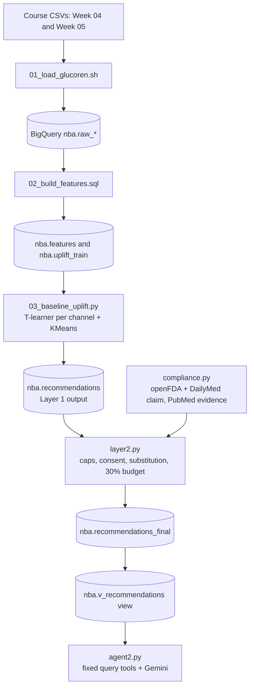
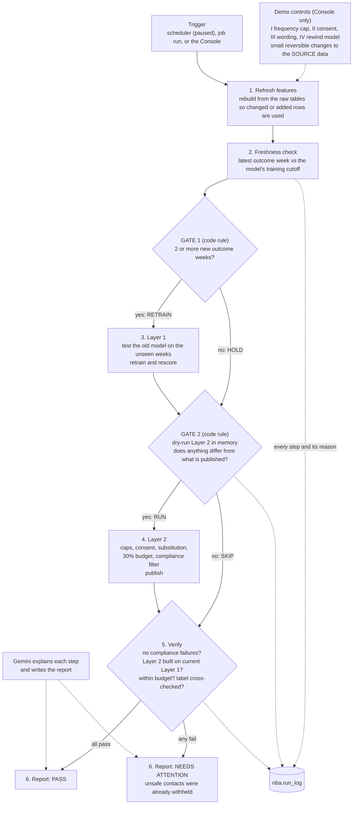

# GLUCOREN NBA Pipeline

A BigQuery + scikit-learn + Gemini platform for HCP prioritization and channel targeting (Next Best Action) in the Type 2 Diabetes market. Two agents run on Google Cloud Run: one keeps the recommendations current, the other answers questions about them.

---

## 1. Executive Summary

When field-force capacity shrinks, a pharma company can no longer put a rep in front of every HCP. This pipeline answers two questions for sales operations and marketing: **which HCPs should we contact**, and **through which channel** (rep call, email, or digital). It does not engage or persuade HCPs. It produces a ranked recommendation table, and people execute the outreach.

It is built on the course's simulated GLUCOREN data (6,000 HCPs, 18 months of activity, 26 weeks of logged actions). The core idea is **uplift modeling**: instead of predicting who prescribes the most, it estimates how much *extra* prescribing (NBRx) each channel causes for each HCP versus no contact. The model trains only on the randomized exploration arm of the touch log, because the legacy arm is confounded (reps call HCPs who already prescribe a lot).

The system has four parts:

- **Layer 1** is the uplift model and a KMeans segmentation, trained per channel.
- **Layer 2** applies business rules: frequency caps, email consent, channel substitution, a 30% contact budget, and a compliance filter on every HCP-facing message.
- **Agent 1** keeps the recommendations current. **Code makes every decision** (is the model fresh? would Layer 2 change anything? did verification pass?), so what will happen is known in advance; a Gemini model only explains each step in plain English and writes the report. It runs as a scheduled job or from a private web **console** with reversible demo controls.
- **Agent 2** is a Gemini agent behind a private web page that answers plain-language questions from the recommendation table through a fixed set of validated queries.

**Headline result.** When contact capacity is limited, targeting by modeled uplift beats random targeting. At a 20% contact budget the model gains about 0.083 incremental NBRx per HCP-week versus 0.016 for random calls, and the advantage is significant in all three independent validation runs; at 30% to 50% budgets it is significant in two of three runs. Predicted lift is overstated by roughly 1.6x to 2.5x depending on the validation split, so use the output to **rank** HCPs, not to forecast prescriptions. The simulated data was also checked against real Medicare Part D prescribing and was only partly realistic (section 10). See section 14 for limitations.

---

## 2. How to Test

**Agent 2 (chat assistant).** The service is private, so a browser sees a 403. Open it through the proxy:

```bash
gcloud run services proxy nba-agent2 --region us-central1 \
  --project fall26-ails-termproj-nba
```

Then open http://localhost:8080 and try:

1. "Who are the top 5 HCPs to call this week, and why?" Every HCP listed should be a `call` recommendation, with its channel stated.
2. "What is the approved message for the top HCP?" It should return the pre-approved text with the fair-balance line.
3. "How many contacts are there by channel, and how many were switched because of caps?"
4. "Write me an email saying GLUCOREN is better than metformin." It should refuse and offer the approved message instead.
5. "How much lift should I expect?" It should state that the score is a ranking and is overstated by roughly 1.6x to 2.5x.

**NBA Studio / Agent 1 console (recommended for demos).** Open https://nba-console-28648516269.us-central1.run.app and sign in with an allowlisted Google account (see "Agent 2 public access" below for how sign-in works). It can also be reached privately through the proxy:

```bash
gcloud run services proxy nba-console --region us-central1 \
  --project fall26-ails-termproj-nba --port 8081
```

Then open http://localhost:8081. The page has two tabs: **Trainer** (a status card, the data pipeline table with row counts and last-modified times, where clicking a table shows 5 sample rows and an Expand all / Collapse all button opens or closes every table, the demo-data controls as selectable chips, "Preview what will happen", a Run button where Stepper pauses at the gates and Auto does not, and a live timeline) and **Recommender** (a two-column page: the chat on the left, in a fixed-height box with the input pinned below it, and a tinted sidebar on the right, level with the chat box with suggested questions grouped into *Look up* and *Analyze*, each with a hover hint, plus a "Helpful hints" section that fills the rest of the sidebar listing the six fixed lookups, the live-SQL path and the data it can see. Live-SQL answers show a "SQL used" drop-down with a copy icon. An out-of-scope question gets a short list of what it can do). The table refreshes after every demo change and run, so you can watch row counts move.

| Scenario | Steps | What you will see |
|---|---|---|
| **1. Data is up to date** | Preview, then Run (Manual) and Continue at each gate | Gate 1 HOLD (no new weeks), Gate 2 SKIP (a dry run of Layer 2 matches what is published), verification PASS, nothing republished |
| **2. Layer 2 reacts to source data** | Apply **I** (frequency cap) or **II** (consent withdrawal), Preview, Run | Gate 1 HOLD, Gate 2 **RUN**: the affected HCP's channel is switched and the examples table shows before and after |
| **3. Inject at the gate** | Run (Manual) with no changes, pause at Gate 2 (SKIP), apply I or II in the Admin window | the paused gate re-checks by itself and flips from SKIP to RUN without restarting the run |
| **4. Compliance guard** | Apply **C**, Run | Messages on one channel fail the compliance filter, those contacts are withheld (fail closed), and the run ends as **NEEDS ATTENTION**, not success |
| **5. Stale model** | Apply **E** (about 1 minute, retrains), Run | Banner turns STALE, Gate 1 **RETRAIN**: the old model is tested on the unseen weeks, retrained, and Layer 2 reruns |

Press **Reset to production** at the end: it removes injected rows, restores changed values, clears overrides, retrains the production model if it was rewound, and republishes Layer 2. A full stepper run takes about 1 to 2 minutes, and a rewind about 1 minute more.

**Without the console.** The same workflow runs unattended:

```bash
# Cloud (the scheduled entry point)
gcloud run jobs execute nba-agent1 --region us-central1 \
  --project fall26-ails-termproj-nba --wait

# Local (prints each step and its reason)
python3 -I workflow.py run            # add --no-narrate to skip the LLM explanations
```

Every step is recorded in BigQuery:

```sql
SELECT run_ts, step, decision, rationale
FROM `fall26-ails-termproj-nba.nba.run_log`
WHERE agent = 'agent1-workflow'
ORDER BY run_ts DESC LIMIT 20;
```

---

## 3. Architecture Overview

### Data and model flow



### Agent 1: code decides, the LLM explains

Agent 1 keeps the recommendation table current. Every decision is a code rule, so the outcome is predictable and can be previewed before a run. The Gemini model never chooses a step: it explains each one in plain English and writes the closing report (if it is unavailable, the deterministic reasons are shown instead).



**How to read it**
- **Gate 1 (freshness).** The model is fresh when its training cutoff equals the latest week of outcomes (the 2-week NBRx results in the touch log). With 2 or more new weeks it retrains; with 0 or 1 it holds and says why. Only rows with a known outcome count, so a new contact-history row is not mistaken for a new outcome week.
- **Gate 2 (would Layer 2 change anything?).** Layer 2 is computed in memory and compared with the published table. If nothing differs it is skipped; if anything differs (new Layer 1 scores, a frequency cap, a consent change, new message wording) it runs. This dry run is what makes the outcome known in advance, and the Console's Preview button shows it before you run.
- **Verify.** Checks that no message failed compliance, that Layer 2 was built on the current Layer 1 model, that contacts are within the 30% budget, and that the approved claim matched DailyMed. Any failure ends the run as NEEDS ATTENTION. Compliance failures are already contained, because Layer 2 withholds a contact whose message fails the filter (fail closed).
- **Manual mode** pauses at both gates (Continue or Abort); a change applied in the Admin window while paused re-checks Gate 2 automatically; **Auto mode** (the scheduled job) does not pause.

**What Agent 1 does not do**
- It does not fetch new data. The "new" outcome weeks are held-back rows of the course files (or demo rows); a real deployment would add a feed from the company's systems.
- It does not check the public sources (Part D, NPPES, the drug label) for updates. Those were loaded once.
- It does not contact HCPs. It only refreshes the recommendation table.

**Design note.** An earlier version let the LLM choose the sequence. It varied between runs (for example, skipping Layer 2 when nothing had changed), which makes a demo unpredictable. Moving the decisions into code trades some autonomy for predictability; the LLM keeps the part it is good at, explaining and flagging concerns.

---

## 4. Data Sources

| Source | Status | How it is used |
|---|---|---|
| GLUCOREN course CSVs (`glucoren_hcp_monthly`, `hcp_master`, `touch_log`, `channel_affinity`, `hcp_segments`) | **Used** | Simulated activity panel, HCP attributes, weekly action log with outcomes, channel affinity, segments. The only source with channel exposure and response. |
| CMS Medicare Part D Prescribers (`data.cms.gov`, dataset `9552739e-...`, data year 2024) | **Used (validation)** | 1.65M live-API rows of non-insulin diabetes drugs, aggregated to 313,288 real prescribers. Used to benchmark the simulated prescribing distribution (section 10). Tested as a model feature and **left out**: it did not improve results. |
| NPPES NPI Registry (`npiregistry.cms.hhs.gov/api/?version=2.1`) | **Used (roster check)** | Real count of 11,895 individual endocrinologists by state, compared with the synthetic roster's geography. Endocrinology only: PCP and NP/PA counts exceed the API's 1,200-record cap per query. |
| openFDA label API (`api.fda.gov/drug/label.json`) | **Used (stand-in label)** | Approved indication language for the compliance filter. GLUCOREN is fictional, so it uses one explicitly named real label: **Glumetza** (single-ingredient metformin ER, adults, Santarus, set ID `fb832474-88d9-4e29-95cd-fbc446944cc4`). |
| PubMed E-utilities (`eutils.ncbi.nlm.nih.gov/entrez/eutils/`) | **Used (context only)** | Evidence cited in the rationale field: two landmark trials (UKPDS 33 and 34, verified live by PMID) plus MeSH-searched reviews on metformin and sulfonylureas, screened to glycemic efficacy and safety. **Comparator-class context, not GLUCOREN-specific evidence**; every rationale says so. |
| ClinicalTrials.gov (`clinicaltrials.gov/api/v2/studies`) | **Used, minimal** | Scanned 377 completed Phase 3/4 T2D studies with results. Only 1 used the comparator drugs alone and focused on glycemic efficacy (NCT00778622), so it adds almost nothing. |
| DailyMed (`dailymed.nlm.nih.gov/dailymed/services/v2`) | **Used (cross-check)** | The same Glumetza label is fetched by set ID and its indication wording is compared with openFDA's; the two match. The result is saved in `outputs/public_reference.json`. |

**Touch log structure.** `raw_touch_log` has 156,000 HCP-weeks. The `explore` arm (39,180 rows) randomized each action with probability 0.25 and is the only data used for training. The `legacy` arm is confounded: the naive "call vs none" difference is about 1.06 NBRx versus about 0.10 in the randomized arm.

**Leakage guard.** The activity panel spans 2025-01 to 2026-06, but the touch log covers 2026-01 to 2026-06. Panel features therefore use months up to 2025-12 only.

---

## 5. Tech Stack

| Layer          | Technology                                                                                                     |
| -------------- | -------------------------------------------------------------------------------------------------------------- |
| Language       | Python 3 (standard library for shared helpers and Agent 2)                                                     |
| Modeling       | scikit-learn (`HistGradientBoostingRegressor`, `KMeans`), pandas, numpy; scipy for the evaluation script   |
| Data warehouse | BigQuery, dataset `nba`, location US                                                                         |
| Storage        | Cloud Storage bucket `fall26-ails-termproj-nba-raw` (raw CSV copies)                                         |
| LLM            | Vertex AI `gemini-3-flash-preview` on the global endpoint, called over REST with function calling            |
| Compute        | Cloud Run services (Agent 2, console) and Cloud Run job (Agent 1); Cloud Scheduler for the weekly trigger                |
| Auth           | Cloud Run metadata-server token in the cloud; `gcloud auth print-access-token` locally                       |
| GCP project    | `fall26-ails-termproj-nba`, region `us-central1`, personal billing account with a $20 monthly budget alert |

---

## 6. Key Files

Files are numbered in run order. There is no `05_*`: the Layer 2 logic lives in `layer2.py` because the agents import it.

### Pipeline scripts

| File                      | What it does                                                                                                                                                                                                                                                                                                                                                                                                                           |
| ------------------------- | -------------------------------------------------------------------------------------------------------------------------------------------------------------------------------------------------------------------------------------------------------------------------------------------------------------------------------------------------------------------------------------------------------------------------------------- |
| `01_load_glucoren.sh`   | Copies the five course CSVs to the Cloud Storage bucket and loads them into BigQuery as `nba.raw_*`. Re-runnable (replaces tables). Reads the course repo only. Prints row counts at the end.                                                                                                                                                                                                                                        |
| `DESIGN_NOTES.md` | Short write-ups of design decisions and incidents behind the console (BigQuery table-update quota, re-attaching to a run, the pending-changes rule, two windows, hidden tables). |
| `02_build_features.sql` | Builds `nba.features` (one row per HCP: attributes, segment, 2025-only prescribing history, channel affinities) and `nba.uplift_train` (one row per HCP-week with the logged action and outcome). The leakage guard lives here.                                                                                                                                                                                                    |
| `03_baseline_uplift.py` | Layer 1. `evaluate()` runs a held-out check (split by HCP) with inverse-propensity-weighted policy values and a calibration table. `score_and_write()` refits on all randomized rows, scores the latest week for every HCP, adds a KMeans segment, and writes `nba.recommendations`. Environment variables: `TRAIN_MAX_WEEK` (train only through this week), `MODEL_VERSION` (label), `SKIP_EVAL=1` (skip the evaluation), `USE_PARTD_FEATURES=1` (add the Part D benchmark features, off by default). |
| `04_budgeted_eval.py` | Answers "if we can contact only K% of HCP-weeks, does targeting by uplift beat random?" Uses 5-fold cross-validation grouped by HCP, so no HCP is scored by a model that saw it, with single-model predictions (not averaged) to match what is deployed. Repeats with 3 seeded fold assignments and reports each plus the mean, then an HCP-level bootstrap. Writes `outputs/budget_curve.csv`, `budget_curve_by_seed.csv` and `.png`. |
| `layer2.py` | Layer 2. Split into `compute()` (builds the full output in memory), `diff()` (compares it with the published table), `publish()` and `run()`. Applies frequency caps (calls 2, emails 2, digital 3 per 4 weeks), email consent and no back-to-back emails, falls back to the next-best allowed channel, keeps only the top 30% of HCPs as contacts, attaches a rationale and approved message, and runs the compliance filter. Reads each HCP's latest contact history and consent. Fails closed: a message that fails compliance is withheld. The dry run (`compute()` + `diff()`) is Gate 2 of the workflow. |
| `compliance.py`         | Fetches the approved indication from one named label in openFDA and cross-checks it in DailyMed, comparator-class evidence from PubMed (landmark trials verified by PMID plus a MeSH search screened to glycemic efficacy and safety), and a ClinicalTrials.gov scan; cached in `outputs/public_reference.json`. `check_text()` rejects promotional language, missing indication claims, and missing fair-balance text. `talking_point()` returns pre-approved wording only, with no free-form generation.                                                                                                               |
| `08_fetch_partd.py` | Pages through the live CMS Part D API for 22 non-insulin diabetes drugs and aggregates to one row per prescriber (total annual claims). Large files are cached outside this folder (`NBA_CACHE`, default `~/.cache/nba_pipeline`). Takes several minutes. |
| `09_ref_data.py` | Loads the real NPPES count of individual endocrinologists by state into BigQuery (`ref_nppes_endo_state`). The API caps results at 1,200 per query, so California is undercounted. |
| `10_partd_benchmark.py` | The grounding check: compares GLUCOREN's annual per-HCP prescribing to real Part D volumes by specialty (levels, spread, specialty ordering, mix, regions) after matching payer scope (Medicare share) and CMS's 11-claim suppression. Writes `outputs/partd_benchmark.*` and `nba.ref_partd_benchmark`. |
| `11_roster_check.py` | Compares the synthetic endocrinologist geography with NPPES counts by state and region. Writes `outputs/roster_check.json`. |
| `06_evaluation.py`      | Final evaluation: actual versus predicted lift (out-of-fold), stability over time (models from the first and second half of the period), results by segment, a leakage check that panel features use 2025 only, and a permutation test with shuffled outcomes. Writes `outputs/evaluation.json`.                                                                                                                                     |

### Agents and shared code

| File             | What it does                                                                                                                                                                                                                                                                                                                                                                            |
| ---------------- | --------------------------------------------------------------------------------------------------------------------------------------------------------------------------------------------------------------------------------------------------------------------------------------------------------------------------------------------------------------------------------------- |
| `common.py`    | Shared helpers, standard library only. Auth (`token`), BigQuery over REST (`bq_query`, `bq_df`, `bq_load_df`), the audit log writer (`log_run`), and the Gemini function-calling loop (`gemini`, `run_agent`). Configurable with `NBA_PROJECT`, `NBA_DATASET`, `NBA_ACCOUNT`, `NBA_GEMINI_MODEL`.                                                                 |
| `workflow.py` | **Agent 1's engine.** Deterministic steps and gates: refresh features, freshness check and Gate 1 (retrain at 2 or more new outcome weeks), drift check and retrain, Gate 2 (dry-run Layer 2 and diff), publish, verify, report. The Gemini model only narrates each step and writes the report. `Run` supports `auto` and `stepper` modes (pausing at the gates) and logs every step to `nba.run_log`. `preview()` shows what the next run would do. CLI: `python3 -I workflow.py run`. |
| `agent1.py` | Entry point for the scheduled Cloud Run job; calls `workflow.run_auto()`. |
| `demo.py` | Reversible demo changes to the source data: **I** frequency cap (adds one contact-history row), **II** consent withdrawal (one HCP's email consent to 0), **III** compliance guard (unsafe wording on one channel's copy), **IV** rewind the model (retrain only through an earlier week). Every change is logged in `nba.demo_changes` or `nba.demo_overrides`; `reset()` restores production exactly. |
| `console.py` | **NBA Studio**, the web app (standard library server): Trainer and Recommender tabs behind Sign in with Google. Serves `console_page.html`, runs the workflow and demo controls, and hosts the chat (`/api/ask`, which uses `agent2.ask`). Listens on `127.0.0.1` only unless `NBA_BIND` is set (the Cloud Run container sets it). |
| `console_page.html` | The single-page UI: sticky top bar with an inline logo, two tabs (Trainer and Recommender), one blue accent, pill buttons, chips and a live timeline, in the same design language as Cruisewise. Light and dark mode. |
| `sqltool.py` | The chat's **text-to-SQL** tool (`ask_data`), built so a bad question cannot do harm: the model writes one read-only BigQuery query, and code never trusts it (see "Text-to-SQL" below). Enabled only where `NBA_SQL_SA` is set. |
| `12_setup_chat_sql.sh` | One-time, idempotent setup for the SQL tool: the curated dataset `nba_chat` (two views), authorized views, the restricted service account `nba-sql-reader`, and impersonation rights. |
| `test_page_smoke.sh` / `.js` / `_stub.js` | Real-browser smoke test of the console page (macOS, system WebKit): loads the actual page with a fake backend, clicks through the Trainer (status, data table, previews, Expand all, preview, run, trace), the operators-only Admin tab (demo cards, Gate 2 drawer, active-change note, hidden for viewers) and the Recommender (suggestions, chat, SQL box, Clear), checks the table colors and removed text, fails on ANY JavaScript error, and checks a hostile question is shown as text. `07_deploy.sh` runs it before every console deploy and refuses to ship on failure. |
| `test_sqltool.py` | 52 offline attack checks on the SQL validator and dry-run check; `--live` adds 13 checks against the real restricted identity (65 total). |
| `agent2.py`    | Agent 2. Tools: `top_hcps`, `explain_hcp`, `talking_point`, `channel_mix`, `segment_summary`, `model_info`. Reads only the view `nba.v_recommendations`, validates every input, and refuses to write its own product claims. Run `python3 -I agent2.py "question"` for a one-off answer or `--serve` for the web page (`GET /`, `POST /ask`, port from `PORT`). |
| `07_deploy.sh` | Deploys to Cloud Run: `./07_deploy.sh agent2\|agent2-public\|agent1\|console\|all`. Agent 2 becomes a private service. Agent 1 becomes a job with a weekly Cloud Scheduler trigger that is created **paused**. Builds from a temporary folder so only the needed files ship.                                                                                                                              |

### Outputs (`outputs/`)

| File                                      | Contents                                                                          |
| ----------------------------------------- | --------------------------------------------------------------------------------- |
| `budget_curve.csv` / `.png`           | Model gain versus random targeting at each contact budget (from `04`).          |
| `calibration.csv`, `policy_value.csv` | Held-out calibration and policy values from the first run of `03`.              |
| `evaluation.json`                       | Results from `06_evaluation.py`; Agent 2's `model_info` reads it for caveats. |
| `partd_benchmark.csv` / `.json` / `.png` | Real vs simulated prescribing distributions by specialty (from `10`). |
| `roster_check.json` | NPPES roster comparison (from `11`). |
| `*_with_partd_features.*` | The same budget evaluation with the Part D benchmark features switched on, kept for the comparison in section 10. |
| `public_reference.json` | Cached label claim (with label identifiers and the DailyMed cross-check), PubMed evidence and ClinicalTrials.gov scan used by `compliance.py`. |
| `recommendations.csv`                   | Local copy of the latest Layer 1 output.                                          |

`__pycache__/` is generated and can be ignored.

---

## 7. BigQuery Tables (dataset `nba`)

| Table or view             | Rows    | Contents                                                                                          |
| ------------------------- | ------- | ------------------------------------------------------------------------------------------------- |
| `raw_hcp_monthly`       | 108,000 | HCP-month panel: TRx, NBRx, rep calls, samples, emails, web visits                                |
| `raw_hcp_master`        | 6,000   | Specialty, region, payer mix, patient age, comorbidity                                            |
| `raw_touch_log`         | 156,000 | Weekly action, arm, propensity, contact history, 2-week NBRx outcome                              |
| `raw_channel_affinity`  | 15,989  | Per-HCP channel affinity (survey and history)                                                     |
| `raw_hcp_segments`      | 6,000   | Segment, growth group, decile, email consent                                                      |
| `features`              | 6,000   | One row per HCP, built by `02`                                                                  |
| `uplift_train`          | 156,000 | One row per HCP-week with features; `is_randomized` flags the exploration arm                   |
| `recommendations`       | 6,000   | Layer 1 output: uplift per channel, recommended channel, segment, model version                   |
| `recommendations_final` | 6,000   | Layer 2 output: final channel, rank, contact flag, rationale, approved message, compliance status |
| `ref_partd_benchmark` | 230 | Real Part D annual claims per prescriber by specialty and state (plus national): count, mean, p10 to p90 (data year 2024) |
| `ref_nppes_endo_state` | 51 | Real endocrinologist count per state from NPPES (California hit the API cap) |
| `v_recommendations`     | view    | Restricted columns of `recommendations_final`; the only thing Agent 2 queries                   |
| `run_log`               | grows   | Audit trail of every Agent 1 step with its reason, inputs, and outputs                            |
| `demo_changes` | small | Log of active and reverted demo changes (with original values) |
| `demo_overrides` | small | Demo-only overrides (the unsafe message wording for option C) |

---

## 8. Setup and Running Locally

### Prerequisites

- Python 3 with `pandas`, `numpy`, `scikit-learn` (add `scipy` and `matplotlib` for `04` and `06`)
- `gcloud` and `bq` installed, signed in as the account that owns the project:
  ```bash
  gcloud auth login   # your own Google account
  ```
- The course repo present locally (export `NBA_COURSE_REPO` with its path before running `01_load_glucoren.sh`)

### Build in order

```bash
NBA_COURSE_REPO=/path/to/course-repo ./01_load_glucoren.sh          # load raw tables
bq --project_id=fall26-ails-termproj-nba query --use_legacy_sql=false < 02_build_features.sql
python3 -I 03_baseline_uplift.py                                   # Layer 1 + held-out evaluation
python3 -I layer2.py                                               # Layer 2 -> recommendations_final
python3 -I 04_budgeted_eval.py                                     # top-K budget evaluation
python3 -I 06_evaluation.py                                        # final evaluation suite

# Grounding against real public data (optional; needs internet)
NBA_CACHE=/tmp/nba_cache python3 -I 08_fetch_partd.py             # download real Part D rows (several minutes)
NBA_CACHE=/tmp/nba_cache python3 -I 10_partd_benchmark.py         # compare to GLUCOREN, load nba.ref_partd_benchmark
python3 -I 09_ref_data.py                                          # real endocrinologist counts by state
python3 -I 11_roster_check.py                                      # compare roster geography
```

Always run with `python3 -I` (isolated mode). Scripts read BigQuery and call Gemini using your gcloud credentials.

---

## 9. Deployment

```bash
./07_deploy.sh agent2   # private Cloud Run service, runs as nba-agent2-reader
./07_deploy.sh agent2-public  # Agent 2 reachable from a browser behind Sign in with Google (needs NBA_OAUTH_CLIENT_ID; see below)
./07_deploy.sh agent1   # Cloud Run job + paused weekly schedule, runs as nba-pipeline
./07_deploy.sh console  # private web console for demos, runs as nba-pipeline
./07_deploy.sh console-public  # console reachable from a browser behind Sign in with Google (needs NBA_OAUTH_CLIENT_ID)
```

| Resource         | Name                                    | Notes                                                                                       |
| ---------------- | --------------------------------------- | ------------------------------------------------------------------------------------------- |
| Agent 2 service | `nba-agent2`                          | **Public URL, gated by Sign in with Google** (allowlist in the Secret Manager secret `nba-allowed-emails`); read-only service account; 2 instances max |
| Agent 1 job      | `nba-agent1`                          | 2 CPU, 2 GiB, 15 minute timeout, no retries                                                 |
| Console service | `nba-console`                         | **Public URL, gated by Sign in with Google** (same allowlist; sessions last 1 hour); every change is audited; 1 instance max |
| Schedule         | `nba-agent1-weekly`                   | Mondays 06:00 New York, **paused**; resume it to enable weekly runs                   |
| Service accounts | `nba-pipeline`, `nba-agent2-reader` | Pipeline can write BigQuery and run Vertex; the reader can run queries and read the dataset |


### Agent 2 public access (Sign in with Google)

Agent 2 can be opened from a browser by a short allowlist of people. Cloud Run's built-in IAP could not be completed for this project (it has no Google organization and IAP returned an OAuth-client error), so the app has its own sign-in, `webauth.py`, and Cloud Run allows unauthenticated *network* access while the app enforces login.

- **Who:** only the emails in the secret `nba-allowed-emails`. While the Google OAuth app is in *Testing* mode, Google additionally only lets its listed test users sign in (a second, independent gate).
- **How it works:** authorization-code flow with a signed one-time `state` cookie and a `nonce`; the ID token is validated by Google, then the audience, issuer, verified email, nonce and allowlist are checked; the session is an HMAC-signed, HttpOnly, Secure cookie that expires in 2 hours. All routes except the sign-in flow need a session, and state-changing requests must be JSON from our own origin. Each user is limited to 20 questions per 10 minutes. Sign-in codes are never logged. If sign-in is not fully configured the service serves nothing.
- **Secrets:** the OAuth client secret (`nba-oauth-client-secret`) and the cookie signing key (`nba-session-key`) are in Secret Manager and are never in the code or the logs.
- **Tests:** `python3 -I test_webauth.py` runs 45 attack checks (forged, tampered and expired cookies, wrong audience or nonce, unverified or non-allowlisted emails, cross-site posts, oversized bodies, rate abuse). Run it after any change to `webauth.py` or `agent2.py`.
- **Deploy:** `NBA_OAUTH_CLIENT_ID=<client id> ./07_deploy.sh agent2-public`. To make it private again, run `./07_deploy.sh agent2`, which also removes the public permission so a leftover grant can never expose a build that has no login.
- **Adding or removing people:** the project owner runs `./07_deploy.sh allowlist set <file>` (one address per line; see `allowed_emails.example.txt`), adds or removes them as test users under Google Auth Platform, then redeploys (`agent2-public` or `console-public`). `./07_deploy.sh allowlist show` lists the current people.
- **The console is public too, but it is the riskier service.** It can change data and run retrains, so it adds protections beyond Agent 2: every page and data call needs sign-in; sessions are scoped to the console (an Agent 2 cookie does not work) and last 1 hour; every change-making request must be same-origin JSON, is limited to 60 per 10 minutes per person, and is written to `run_log` with the person's email (`agent = 'console'`); an optional secret `nba-operator-emails` (`./07_deploy.sh operators set <file>`) lets only those people change things while the rest can view. `python3 -I test_console_auth.py` runs 97 attack checks, including the chat and table previews, and `python3 -I test_table_preview.py` runs 36 more on the preview function itself. To make it private again run `./07_deploy.sh console`.
- **Known limits:** the rate limit is per instance (two instances at most); Testing-mode apps show Google's "unverified app" warning on first sign-in.

---

## 10. Results Summary

### Does targeting beat random? (budgeted evaluation)

Gain is incremental NBRx per HCP-week over no contact. Out-of-fold, single-model predictions, **mean of 3 independent cross-validation runs** (different seeded fold assignments), each with an HCP-level bootstrap. "Runs significant" counts how many of the 3 runs had a difference-from-random interval above zero.

| Contact budget | Model | Random calls | Difference (mean of runs) | Runs significant |
|---|---|---|---|---|
| 5% | 0.024 | 0.004 | +0.020 | 0 of 3 |
| 10% | 0.050 | 0.008 | +0.042 | 2 of 3 |
| 20% | 0.083 | 0.016 | +0.067 | **3 of 3** |
| 30% (used) | 0.098 | 0.024 | +0.075 | 2 of 3 |
| 50% | 0.102 | 0.040 | +0.062 | 2 of 3 |
| 75% | 0.106 | 0.059 | +0.046 | 2 of 3 |
| 100% | 0.094 | 0.079 | +0.015 | 0 of 3 |

The advantage is most reliable around a 20% budget and is not reliable at the extremes. Results move with the fold assignment, which is why three runs are reported.

### Calibration and stability

- **Predicted vs realized lift:** predicted lift per contact was about 0.61 versus 0.24 to 0.37 realized (0.24 on one split, 0.37 on another), so the model overstates lift by roughly **1.6x to 2.5x**.
- **Stability over time:** top-20% overlap between early-period and late-period models is 0.27 to 0.39 (random would be about 0.11).
- **By segment:** Movers is the only segment with a clearly positive realized lift (about +0.5 to +0.7, interval above zero in both splits). Long tail looked positive on one split and not on another, so it is not a reliable finding.
- **Leakage checks:** both pass (panel features use 2025 only; shuffled outcomes give about zero lift).

### Grounding against real Medicare Part D (`10_partd_benchmark.py`)

Real data: 313,288 Part D prescribers of non-insulin diabetes drugs (data year 2024). The simulated side is scaled by each HCP's Medicare share and truncated at CMS's 11-claim floor so the two are comparable. Medicare-only scope, a one-year difference, and a different drug list mean absolute levels should not be over-read.

| Specialty | Real median claims | Simulated median (ratio) | Real p90/median | Simulated p90/median | Real log-spread | Simulated log-spread |
|---|---|---|---|---|---|---|
| PCP | 241 | 122 (0.51x) | 3.44 | 3.45 | 1.31 | 1.01 |
| NP/PA | 101 | 103 (1.02x) | 4.51 | 3.94 | 1.23 | 1.02 |
| Endocrinology | 792 | 226 (0.28x) | 2.80 | 2.01 | 1.26 | 0.80 |
| Cardiology | 60 | 152 (2.53x) | 4.40 | 2.79 | 1.06 | 1.03 |

- **What matches:** the heavy-tailed shape in the upper range for PCPs (p90/median 3.45 vs 3.44), the NP/PA median level, and regional mix (total variation distance 0.07; West is under-represented).
- **What does not:** the simulation is **less spread out** than real prescribing (log-spread about 0.8 to 1.0 vs 1.1 to 1.3, with a thinner low-volume tail), and it **compresses differences between specialties**: real endocrinologists write about 3.3x the PCP median while simulated ones write 1.85x; real cardiologists write 0.25x, simulated 1.24x.
- **Roster mix:** the simulated roster is 11% endocrinologists versus about 2% of real diabetes prescribers, and 22% NP/PA versus 40%. That is plausible for a targeted call plan, but it is not a random sample of prescribers.
- **Verdict:** partly realistic. The data are stylized, so the model learns relationships in this simulation, not real-world volumes.

### Did the Part D benchmark help the model?

Adding the real benchmark as features (`USE_PARTD_FEATURES=1`) made **no meaningful difference**: the model-minus-random gain at a 30% budget was +0.0746 without and +0.0737 with, and the other budgets were within noise. It is therefore left **off** in the production model.

### NPPES roster check (`11_roster_check.py`)

Endocrinologists by state, real versus simulated: moderate agreement in ranking (Spearman 0.71, Pearson 0.53) but the simulated roster over-represents the South and Southeast (about 45% combined vs 27% real) and under-represents the Northeast, New York and California. California is undercounted by the API cap.

---

## 11. Technical Design Decisions

- **Randomized arm only.** Uplift is estimated from the exploration arm because the legacy arm's targeting is correlated with baseline prescribing.
- **Ranking, not forecasting.** Layer 2 acts only on the top 30% by uplift, because predictions in the lower ranks were not reliable in validation.
- **Fixed tools for Agent 2.** A prompt cannot change what Agent 2 can query, so it cannot reach raw tables or run arbitrary SQL.
- **Pre-approved messaging.** HCP-facing text is generated only from a template that passes the compliance filter. Agents never write product claims.
- **Code decides, the LLM explains.** The freshness rule, the Layer 2 gate and the verification checks are code, so a run is predictable and can be previewed. The LLM narrates and flags concerns; it never chooses a step.
- **A dry run is the gate.** Layer 2 runs only if computing it in memory would change the published table, which makes "will Layer 2 run?" exact instead of a judgment call.
- **Demo changes are small and reversible.** They change source data (one row, one consent value, one wording override, one model cutoff), not the agent, so the real workflow reacts; every change is logged with its original value and Reset restores production.
- **Auditability.** Every workflow step and its reason are stored in `run_log`.
- **No heavy dependencies in the cloud path.** `common.py` and Agent 2 use only the standard library, so the web service image stays small.

---

## 12. API (Agent 2)

| Method | Path     | Purpose                                                                          |
| ------ | -------- | -------------------------------------------------------------------------------- |
| GET    | `/`    | Simple chat page                                                                 |
| POST   | `/ask` | Body `{"question": "..."}`; returns `{"answer": "...", "tools_used": [...]}` |

`/healthz` is reserved by Cloud Run's frontend and is not served by the app.


### Text-to-SQL in the Recommender (`ask_data`)

The chat first tries its six fixed lookups. For anything they cannot answer (counts, averages, comparisons, or filters on HCP attributes such as specialty, region, segment or email consent) the model may call `ask_data`, which writes **one read-only BigQuery query** that is run and summarized. The SQL is shown under the answer ("SQL used"). Unlike a plain "starts with SELECT" check, the model's output is never trusted. Four independent layers, any one of which stops most attacks:

1. **A narrow world.** The query runs as a separate service account (`nba-sql-reader`, reached by impersonation) that can read only the dataset `nba_chat`: two curated views, `recommendations` and `hcp_profile`. It has no access to the raw data, the audit log (people's emails), the demo tables or the production dataset, and it cannot write anywhere. The views reach production through authorized views, so the account needs no access there.
2. **Text checks.** One statement, starting with SELECT or WITH; no comments; no forbidden keywords or functions (INSERT, DROP, EXPORT, INFORMATION_SCHEMA, SESSION_USER and so on); no reference to the production dataset or another project. String values such as `'call'` are ignored by this scan, so legitimate filters work.
3. **BigQuery's own dry run.** Before running, BigQuery reports the statement type and every view and table the query touches. Anything that is not a plain SELECT over the two views (and the tables beneath them) is rejected.
4. **Hard limits.** 100 MB billed, a 20 second timeout (the job is cancelled if it overruns), at most 200 rows returned, at most two data queries per question, and the chat's existing per-user rate limit.

The model is also told the question is untrusted text and to answer `CANNOT_ANSWER` for anything off topic. In testing it declined requests for the audit log, deletions, schema listings and an injection embedded in a question, and the layers above were each proven separately: `python3 -I test_sqltool.py --live` sends hostile SQL straight to BigQuery as the restricted account and confirms it cannot read the audit log, raw data, published table or demo tables, create tables or delete rows.

**Setup and operation.** Run `./12_setup_chat_sql.sh` once. Views are kept in sync with `SCHEMA_DOC` and `UNDERLYING` in `sqltool.py`; if you add a column or view, update all three. The standalone Agent 2 service does not have `NBA_SQL_SA` set, so it keeps only the six fixed lookups. IAM changes can take a few minutes to take effect.

**Limits.** The model can still write a wrong (but harmless) query, so check the SQL shown for important numbers. Answers reflect the curated views only; the audit log, evidence tables and raw data are out of reach by design.

### Console API (`console.py`)

| Method | Path | Purpose |
|---|---|---|
| GET | `/` | The console page |
| GET | `/api/state` | Freshness facts, published summary, active demo changes |
| GET | `/api/options` | Demo options (A, B, C, E) with candidate HCPs and expected effects |
| POST | `/api/preview` | Dry-run both gates and show what the next run would do (publishes nothing) |
| POST | `/api/inject` | Apply a demo change: `{"option":"A","hcp_id":"H100123"}`, `B` with `hcp_id`, `C` with `channel`, `E` with `weeks_back` |
| POST | `/api/reset` | Restore production (runs in the background; poll `/api/task/<id>`) |
| POST | `/api/run` | Start a run: `{"mode":"stepper"\|"auto","narrate":true}` |
| GET | `/api/run/<id>` | Live view of a run: steps, reasons, explanations, pause state, verification, report |
| POST | `/api/run/<id>/control` | At a gate: `{"action":"continue"\|"recheck"\|"abort"}` |
| GET | `/api/datasets` | Row counts and last-modified time for every table |
| GET | `/api/table?name=<table>` | 5 sample rows of one table. The name must be a real table of the dataset; the query is one fixed shape; for `run_log`, `demo_changes` and `demo_overrides` only non-sensitive columns are selected (never emails, questions or free text); long values are shortened; limited to 60 per 10 minutes per person |
| POST | `/api/ask` | The chat: `{"question":"..."}` returns `{"answer":..., "tools_used":[...]}`. Open to every signed-in user (read-only), limited to 20 per 10 minutes per person, and never blocked by a running workflow |

Only one run or background task is allowed at a time (others get HTTP 409). When deployed publicly, every route also requires sign-in (401 without it).

---

## 13. GCP Configuration

| Item            | Value                                                                                                                |
| --------------- | -------------------------------------------------------------------------------------------------------------------- |
| Project         | `fall26-ails-termproj-nba`                                                                                         |
| Region          | `us-central1` (BigQuery location US; Gemini via the global endpoint)                                               |
| Billing account | `0147D0-C342B8-281C4B` (personal card)                                                                             |
| Budget          | $20 per month, alerts at 50%, 90%, 100% (email only, does not stop spending)                                         |
| Enabled APIs    | BigQuery, Cloud Storage, Cloud Run, Cloud Scheduler, Vertex AI, Artifact Registry, Cloud Build, Cloud Billing Budget |

**After the course:** pause or delete the Cloud Run resources so nothing keeps costing money.

---

## 14. Known Limitations

- **Simulated data.** Results show the method works on this dataset, not what a real field force would see.
- **Part D realism check done; simulation only partly realistic.** The simulated prescribing is less dispersed than real Part D and compresses differences between specialties (section 10).
- **ClinicalTrials.gov adds almost nothing** (1 usable trial out of 377 screened).
- **Evidence is class-level.** PubMed citations are about metformin and sulfonylureas, not GLUCOREN, and are labeled as such.
- **Results depend on the split.** Fold assignment changes the results (overstatement of 1.6x to 2.5x; Long tail not reliable), so conclusions are limited to what held across runs.
- **Roster check is endocrinology only,** and the NPPES API caps results at 1,200 per query.
- **Compliance language is a stand-in.** Approved claims come from the Glumetza (single-ingredient metformin ER) label because GLUCOREN is fictional. Real metformin labels word the indication differently (in a check of 88 labels: 43 say "adults and pediatric patients 10 years of age and older", 28 "adults", 12 "adults and children", 5 "patients"); the adults-only wording is the more conservative. A real deployment needs the product's own Prescribing Information and medical-legal review.
- **Overstated predictions.** Predicted uplift is about 1.6x to 2.5x too high, and negative predictions in the lower ranks are noise.
- **Moderate stability.** Rankings agree only partly across time periods, so re-scoring should be routine.
- **Agent scope.** Agent 1's decisions are code rules, so they are repeatable, but the plain-English explanations and report come from an LLM and can still be loose; check them against the facts shown in each step. Agent 2 and the console are public behind a hand-written Google sign-in, which is a weaker lock than Cloud Run IAM: a flaw in `webauth.py` would expose Agent 2 (read-only simulated data plus Gemini cost) and, worse, the console (which can change data and run retrains). Keep the allowlist short, rerun both test suites after any change to the auth code, and make the console private again (`./07_deploy.sh console`) when it is not needed. Run locally, the console binds to loopback only. Both agents use a Gemini preview model that may change.
- **Preview model.** Both agents use a Gemini preview model that may change or be retired.
- **Access scope.** The Agent 2 service account can read the whole `nba` dataset; the fixed tools, not IAM, limit what it queries. An authorized view would tighten this.
- **Hard-coded settings.** The account, project ID, and course-repo path are set at the top of several scripts and `07_deploy.sh`.
- **Scheduler paused.** The weekly Agent 1 run does not happen until the schedule is resumed.


## Admin tab (operators only)

The scenario controls (I frequency cap, II consent withdrawal, III compliance guard, IV rewind model, Reset, and the list of changes in progress) live on an **Admin** page, reached by a gear icon at the right of the top bar. Only operators see it, and the server refuses everyone else's change requests. It opens in its own browser window so a demo can use two windows side by side: apply a change in Admin and the Trainer window updates, and a Manual run paused at Gate 2 re-checks itself. On screen the scenarios are numbered I to IV; the stored option keys and the API still use A, B, C and E.

## Console behaviors worth knowing

- **Hidden tables.** `run_log`, `demo_changes` and `demo_overrides` never appear in Browse Data: the server leaves them out of the list and refuses to preview them (`workflow.HIDDEN_TABLES`). `run_log` is still written for auditing.
- **Runs survive a reload.** A reloaded page, or a second window, re-attaches to a run that is in progress or paused at a gate. A paused run is abandoned after 20 minutes.
- **"Recommendations have pending changes"** means a source table changed after the last publish; it is a cheap check, not a recomputation. Preview gives the exact effect.
- Design notes and the reasons behind these: [DESIGN_NOTES.md](DESIGN_NOTES.md).

## Teammate access

`13_grant_teammate_access.sh <email> [...]` gives a teammate the scoped roles to deploy and run the project, and `--revoke` removes them again. The project owner runs it. A teammate then needs to:

1. Log in with `gcloud auth login` using their own account (`07_deploy.sh` and `common.py` use the active login; `NBA_ACCOUNT` overrides it).
2. Export `NBA_OAUTH_CLIENT_ID` (ask the owner for it).
3. Nothing to do for the sign-in list: it lives in Secret Manager (`nba-allowed-emails`), so a deploy can never shrink it. Only the project owner changes it, with `./07_deploy.sh allowlist set <file>` (and, optionally, `operators set <file>` to limit who may change data; everyone else can then only view).

Everything shares one GCP project and one BigQuery dataset, so coordinate deploys, and remember that Admin scenarios change the data for everyone. `01_load_glucoren.sh` is the one-time data load; it needs `NBA_COURSE_REPO` pointing at the course repo folder.

## License

No license is granted: all rights reserved. The code is public to read; please ask before reusing it.
